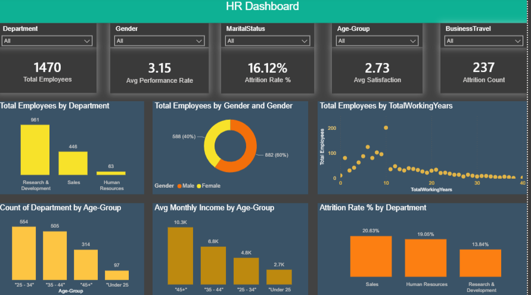

# 📊 HR Analytics & Employee Attrition Dashboard

An interactive and professional Power BI dashboard designed to analyze Human Resources data, monitor workforce metrics, and track employee attrition patterns.

---

## 🚀 Dashboard Preview

---

## 📈 Key Performance Indicators (KPIs)
* **Total Employees:** 1,470
* **Average Performance Rate:** 3.15
* **Overall Attrition Rate:** 16.12%
* **Average Job Satisfaction:** 2.73
* **Total Attrition Count:** 237

---

## 🛠️ Tools & Technologies Used
* **BI Tool:** Power BI Desktop
* **Data Preparation & Transformation:** Power Query (Data cleaning, conditional columns such as Age Groups).
* **Analysis & Modeling (DAX):** Custom measures including `Attrition Rate %`, `Attrition Count`, and `Avg Monthly Income`.
* **UI/UX Design:** Modern Dark Theme optimized for executive reporting and visual clarity.

---

## 📌 Key Insights & Features
1. **Departmental Breakdown:** Visualizes headcount distribution and pinpoints departments with the highest turnover rates.
2. **Attrition Risk Tracking:** Highlights risk areas using color-coded metrics to assist HR management in retention planning.
3. **Socio-Economic Factors:** Explores the relationship between age groups, total working years, and monthly income trends.
4. **Interactive Filtering:** Dynamic slicers for Department, Gender, Marital Status, Age Group, and Business Travel.

---

## 🛡️ License

This project is licensed under the MIT License. You are free to use, modify, and share this project with proper attribution.

## 🌟 About Me

Hi there! I'm Ahmed Alnaggar. I'm a data analyst.

